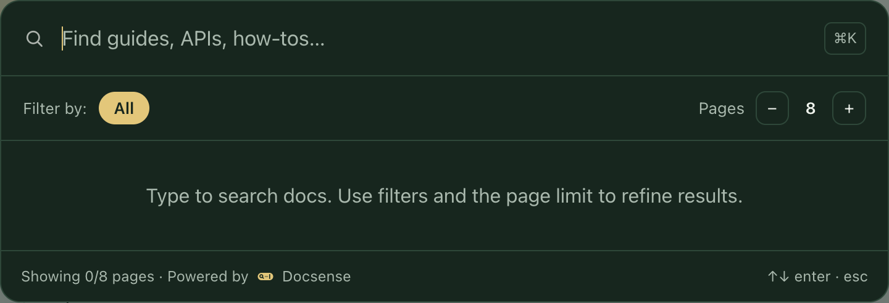
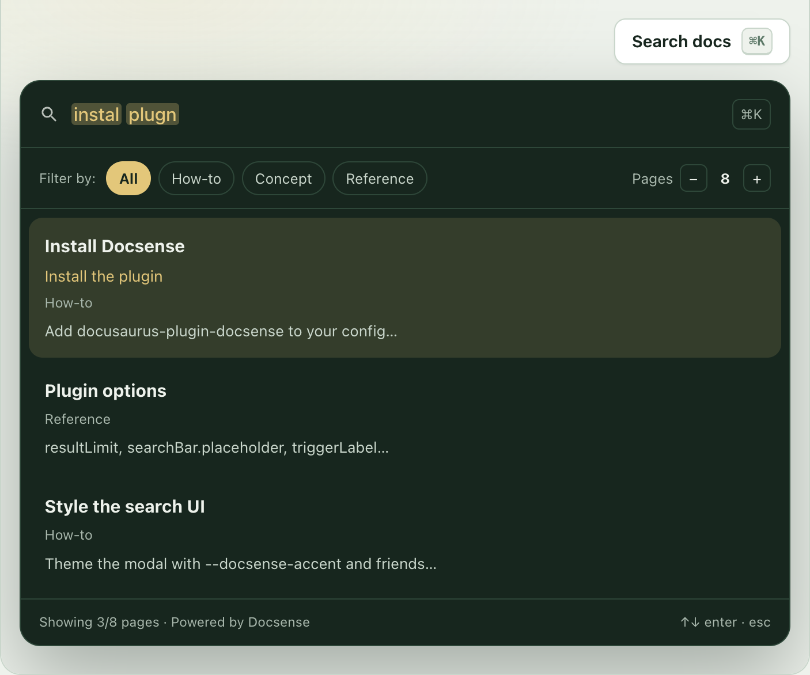
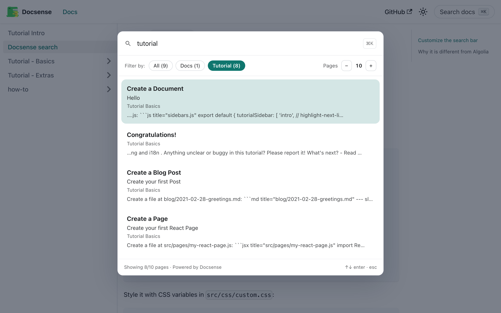

# Docsense

**Open-source, build-time documentation search for Docusaurus.**

[](https://www.npmjs.com/package/docusaurus-plugin-docsense)
[](https://github.com/meharshit/docsense/blob/main/LICENSE)
[](https://meharshit.github.io/docsense/)

**Live demo:** [https://meharshit.github.io/docsense/](https://meharshit.github.io/docsense/) · **npm:** [`docusaurus-plugin-docsense`](https://www.npmjs.com/package/docusaurus-plugin-docsense) · **Install:** `npm install docusaurus-plugin-docsense`

Docsense adds search to your Docusaurus site without hosted search services or external crawlers. During your documentation build, it indexes Markdown and MDX source files into a structured static JSON index that ships and deploys directly with your site. You keep full control over your content, indexing pipeline, and search infrastructure.

<!-- Replace feature-search-modal.png with docs/images/demo.gif once you record a ~10s Loom/GIF. -->
<p align="center">
  
</p>

## Quickstart

### 1. Install

```bash
npm install docusaurus-plugin-docsense
```

### 2. Configure

Register the plugin in your `docusaurus.config.js`:

```js
export default {
  plugins: [
    [
      'docusaurus-plugin-docsense',
      {
        docsDirs: ['docs'],
        docsRouteBasePath: '/docs',
        resultLimit: 8,
        searchBar: {
          placeholder: 'Search the docs…',
          triggerLabel: 'Search docs',
          shortcut: 'mod+k',
          showShortcutHint: true,
        },
      },
    ],
  ],
};
```

You can optionally customize the UI via `themeConfig.docsense` and CSS variables such as `--docsense-accent` in your site stylesheet.

<p align="center">
  
</p>

### 3. Build

```bash
npm run build
```

Running the build generates the static search index at `static/docsense/search-index.json` and automatically registers the SearchBar in your Docusaurus navbar.

## Why Docsense?

Documentation search should not require a separate infrastructure stack. Traditional hosted search solutions often require configuring external services, managing crawler access, and waiting for scheduled indexing jobs to pick up updates.

Docsense brings indexing directly into your existing build workflow:

- **Keep search and documentation together:** Generate your search index as part of your Docusaurus build and deploy both together.
- **Keep search results up to date:** Regenerate the index on every build without waiting for an external crawler.
- **Search private documentation:** Index content locally without sending it to a third-party service. Access to the documentation itself must still be enforced by your application.
- **Avoid hosted search infrastructure:** Serve a static JSON index from your own host instead of maintaining a separate search backend.
- **Retain control over your search data:** Own the generated index and inspect, customize, or extend the open-source codebase.
- **Integrate search out of the box:** Add a ready-to-use SearchBar to your Docusaurus navbar without building the search UI from scratch.

## Architecture and packages

### Indexing pipeline

Docsense runs a five-stage, build-time indexing and runtime search pipeline:

1. **Scan:** Discover Markdown and MDX files across your configured documentation directories.
2. **Parse:** Extract document content, metadata, and section hierarchy.
3. **Index:** Tokenize content and prepare searchable records.
4. **Generate:** Serialize the records into a static JSON index file.
5. **Search:** Load the index via the runtime client and return ranked results.

### Packages

| Package | Responsibility |
|---|---|
| `@docsense/core` | Document model, tokenization, fuzzy matching, ranking, and `search()` API |
| `@docsense/indexer` | Markdown/MDX parsing and structured search index generation |
| `@docsense/runtime` | Lazy-loaded browser and Node.js search client |
| `docusaurus-plugin-docsense` | Docusaurus integration and navbar SearchBar component |

## Core capabilities

- **Build-time indexing:** Scans Markdown and MDX source files during the site build to produce a structured search index. No external crawlers or scheduled jobs are involved. Content changes appear in the next build.
- **Section-level search:** Organizes documentation into searchable sections beyond top-level document titles, so readers can jump directly to relevant passages within a page.
- **Relevant search results:** Combines lexical matching, tokenization, case-insensitive matching, fuzzy matching, and ranking so queries still surface results when terms do not match the source text verbatim.
- **Filters and adjustable page limits:** Refines hits with page-type filters and lets users adjust how many pages display in the modal (default **8**, adjustable directly in the UI).
- **Version and language context:** Tracks version and language metadata in the search model to organize results across multi-version and localized documentation.
- **Lightweight static index:** Outputs a static JSON file that deploys alongside your documentation, without a hosted search backend.
- **Docusaurus integration:** Connects the indexer, search engine, and runtime while adding a navbar SearchBar triggered by `⌘K` (macOS) or `Ctrl+K` (Windows/Linux).

## Feature gallery

### Navbar search

Customizable trigger label, keyboard shortcut hint, and theme styling.


### Search modal

Keyboard-first modal with search input, page-type filters, and page-limit controls.


### Ranked results

Section-aware matches with navigation breadcrumbs and highlighted snippets.


### Filter by page type

Interactive chip filters including All, Docs, How-to, and Tutorial.


### Adjustable page limit

Live stepper controls to increase or decrease the number of displayed pages (default **8**).



## Docsense vs. Algolia DocSearch

Algolia DocSearch is an established hosted search platform for documentation sites. Docsense takes a self-contained approach by generating and serving a static index alongside your documentation.

| Capability | Algolia DocSearch | Docsense |
|---|---|---|
| **Search infrastructure** | Hosted service | Static JSON |
| **Indexing** | External crawler | Build-time indexing |
| **Content source** | Crawled HTML | Markdown and MDX |
| **Index freshness** | Crawler schedule | Every documentation build |
| **Search data ownership** | Managed indexing service | Self-owned index |
| **Filters in the modal** | Hosted facets | Page-type chips |
| **Result limit** | Config / service | Default 8 with live - / + control |
| **License** | Proprietary service | MIT |
| **Docusaurus integration** | Available | Built in |

- **Choose Algolia** when you need a mature hosted search platform and its managed infrastructure.
- **Choose Docsense** when you want search indexing and delivery to stay inside your own build and deployment workflow.

For a broader comparison covering easyops, Orama, Pagefind, and Algolia, see [docs/COMPETITIVE.md](docs/COMPETITIVE.md) or read the [live comparison guide](https://meharshit.github.io/docsense/docs/concepts/compare-open-source-search/).

## Security

Docsense is built so documentation content never needs to leave your deployment boundary for indexing or search queries.

| Measure | What it means |
|---|---|
| **No third-party crawl** | Indexing runs inside your build environment. Markdown and MDX files are never sent to Algolia or another SaaS crawler. |
| **Static index only** | Search relies on a static JSON file deployed with your site. There is no Docsense cloud API handling queries. |
| **Client-side queries** | Lookups execute in the reader's browser against your published index, so there is no separate Docsense query server. |
| **Open, auditable code** | MIT-licensed packages that you can inspect, fork, and version-pin. |
| **Safe browser fetch** | The runtime loads the index through a bound `fetch` wrapper to prevent common browser invocation errors. |
| **Bounded UI limits** | Result limits are clamped between 3 and 20 so clients cannot request unbounded result sets from UI controls. |

**Important:** A public static site still exposes whatever content is included in its published search index. Docsense does not replace authentication, authorization, CDN, WAF, or DDoS protection for your live host. Protect your documentation site the same way you protect any static deployment (CDN, rate limits, WAF). Search continues working as long as your static assets remain available.

## Roadmap

### Current

- Local lexical search with **case-insensitive** matching
- **Deeper typo tolerance** using adaptive Damerau-Levenshtein distance (distance 1 to 2 by token length), prefix matches, and ranked fuzzy scoring
- **English stemming** so word forms such as `installing` and `install` match
- **Improved MDX extraction** for common textish component attributes
- **Destination page term highlighting** after clicking a search result
- Section-level results with breadcrumbs and snippets
- Page-type filters and adjustable page limit (default **8**)
- Version and language context in the search model
- Docusaurus plugin and navbar SearchBar (`⌘K` / `Ctrl+K`)
- Build-time Markdown and MDX indexing to static JSON

### Next

- **Large-site scale:** Sharded / fragment indexes so browsers download only the slices required for a query (Pagefind-class architecture) rather than a single JSON file. This is intentionally deferred because a single JSON file is the right default until index download size becomes a bottleneck, and sharding requires a larger index format and loader redesign.

### Later

- Multi-language and CJK tokenization
- Agent-friendly chunk exports generated from the same index
- Optional pluggable search engines behind the same UI

Ask AI and conversational answers are **not** a near-term focus. Many documentation sites already integrate those tools separately. Docsense stays focused on fast, reliable local search.

## License

Docsense is released under the MIT License.

Copyright © [meharshit](https://github.com/meharshit).

[Explore Docsense on GitHub](https://github.com/meharshit/docsense).
