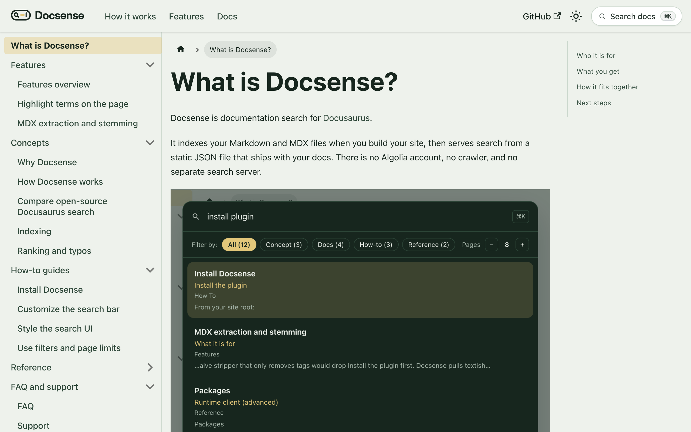
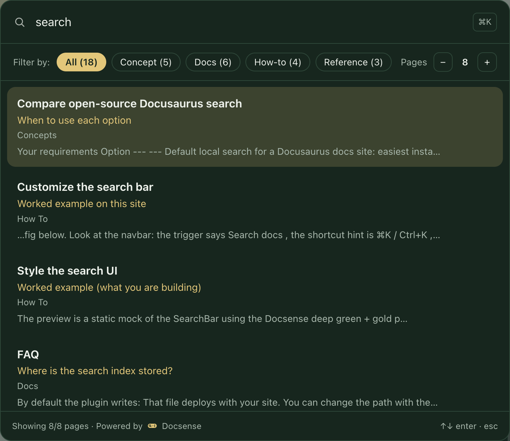
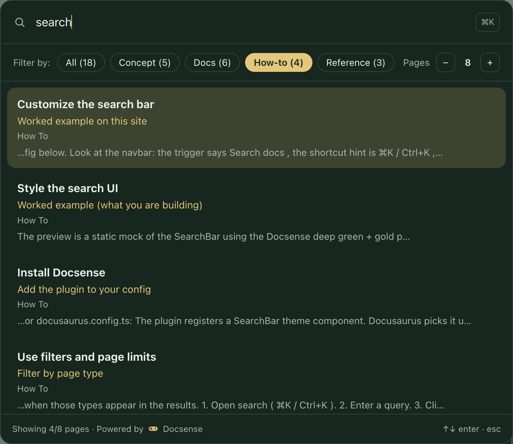

# Docsense

**Open-source documentation search for Docusaurus.**

**Live docs:** [https://meharshit.github.io/docsense/](https://meharshit.github.io/docsense/)

Docsense is a build-time documentation search engine that enables you to add search to your Docusaurus site without depending on hosted search services or external crawlers.

It indexes your Markdown and MDX files during the documentation build, generates a structured search index and makes it available to your site as a static JSON file.

Your search index is generated alongside your documentation and deployed with it. You control the content, indexing process and search infrastructure.

<p align="center">
  
</p>

## Why use Docsense?

Documentation search should not require a separate infrastructure stack.

With traditional hosted search solutions, you may need to configure external services, manage crawler access and wait for scheduled indexing jobs to pick up documentation changes.

Docsense brings indexing into your existing documentation workflow. It removes those external dependencies and gives you direct control over how your documentation is indexed and searched.

Use Docsense when you want to:

- **Keep search and documentation together:** Generate your search index as part of your existing Docusaurus build and deploy both together.
- **Keep search results up to date:** Regenerate the index whenever you build your documentation, without waiting for an external crawler.
- **Search private documentation:** Index documentation locally without sending its content to a third-party search service. Access to the documentation itself must still be enforced by your application.
- **Avoid hosted search infrastructure:** Serve a static JSON index from your own documentation site instead of maintaining a separate search service.
- **Retain control over your search data:** Own your generated index and inspect, customize or extend the open-source implementation.
- **Integrate search into Docusaurus:** Add a ready-to-use SearchBar to your documentation navbar without building the entire search integration yourself.

## Core features

### Build-time indexing

Docsense scans your Markdown and MDX source files during the documentation build and generates a structured search index.

There is no external crawler or scheduled indexing job. Changes to your documentation are reflected in the next generated index.

### Section-level search

Search beyond document titles. Docsense organizes documentation into searchable sections so users can find relevant content within a page rather than having to navigate through entire documents.

### Relevant search results

Docsense includes lexical matching, tokenization, case-insensitive matching, fuzzy matching and ranking to help users find relevant documentation, including when their search terms do not exactly match the source text.

### Filters and adjustable page limits

Refine results with page-type filters and control how many pages appear in the modal (default **8**, adjustable in the UI).

### Version and language context

The search engine supports version and language context, helping organize results across documentation versions and languages.

### Lightweight static index

Docsense generates a static JSON search index that ships with your documentation site. This avoids the need for a separate hosted search backend.

### Docusaurus integration

The Docusaurus plugin connects the indexer, search engine and runtime. It also provides a navbar SearchBar with keyboard shortcuts:

- macOS: `⌘K`
- Windows/Linux: `Ctrl+K`

## Feature gallery

### Navbar search

Customizable trigger label, shortcut hint and theme styling.



### Search modal

Keyboard-first modal with search input, filters and page-limit controls.


### Ranked results

Section-aware hits with breadcrumbs and snippets.



### Filter by page type

Chip filters such as All, Docs, How-to and Tutorial.



### Adjustable page limit

Increase or decrease how many pages are shown (default 8).


## Docsense vs. Algolia DocSearch

Algolia DocSearch is an established hosted search solution for documentation sites. Docsense takes a different architectural approach by generating and serving its index alongside your documentation.

| Capability | Algolia DocSearch | Docsense |
|---|---|---|
| Search infrastructure | Hosted service | Static JSON |
| Indexing | External crawler | Build-time indexing |
| Content source | Crawled HTML | Markdown and MDX |
| Index freshness | Crawler schedule | Every documentation build |
| Search data ownership | Managed indexing service | Self-owned index |
| Filters in the modal | Hosted facets | Page-type chips |
| Result limit | Config / service | Default 8 + live − / + control |
| License | Proprietary service | MIT |
| Docusaurus integration | Available | Built in |

Choose Algolia when you need a mature hosted search platform and its managed infrastructure.

Choose Docsense when you want documentation search to remain part of your own build and deployment workflow.

For a broader comparison with local plugins (easyops, Orama, Pagefind), see [docs/COMPETITIVE.md](docs/COMPETITIVE.md).

## How Docsense works

Docsense follows a build-time indexing pipeline:

1. **Scan:** Discover Markdown and MDX files in your documentation directories.
2. **Parse:** Extract document content, metadata and sections.
3. **Index:** Tokenize content and prepare searchable records.
4. **Generate:** Serialize the index into a static JSON file.
5. **Search:** Load the index through the runtime and return ranked results.

## Packages

| Package | Responsibility |
|---|---|
| `@docsense/core` | Document model, tokenization, fuzzy matching, ranking and `search()` API |
| `@docsense/indexer` | Markdown/MDX parsing and structured search index generation |
| `@docsense/runtime` | Lazy-loaded browser and Node.js search client |
| `docusaurus-plugin-docsense` | Docusaurus integration and SearchBar component |

## Get started

### Install

```bash
npm install docusaurus-plugin-docsense
```

### Configure

Add the plugin to your `docusaurus.config.js`:

```js
export default {
  plugins: [
    [
      'docusaurus-plugin-docsense',
      {
        docsDirs: ['docs'],
        docsRouteBasePath: '/docs',
        resultLimit: 8,
        searchBar: {
          placeholder: 'Search the docs…',
          triggerLabel: 'Search docs',
          shortcut: 'mod+k',
          showShortcutHint: true,
        },
      },
    ],
  ],
};
```

Optional UI customization via `themeConfig.docsense` and CSS variables such as `--docsense-accent` in your site stylesheet.

### Build

```bash
npm run build
```

Docsense generates the search index at:

```text
static/docsense/search-index.json
```

The plugin also registers the SearchBar in your Docusaurus navbar.

## Security

Docsense is designed so documentation content does not need to leave your deployment boundary for search indexing.

| Measure | What it means |
|---|---|
| **No third-party crawl** | Indexing runs in your build. Docsense does not send Markdown/MDX to Algolia or another SaaS crawler. |
| **Static index only** | Search uses a JSON file you deploy with the site. There is no Docsense cloud API for queries. |
| **Client-side queries** | Lookups run in the reader’s browser against your published index. There is no Docsense query server for attackers to overwhelm separately from your docs host. |
| **Open, auditable code** | MIT-licensed packages you can review, fork and pin. |
| **Safe browser fetch** | The runtime loads the index through a bound `fetch` wrapper to avoid common browser invocation bugs. |
| **Bounded UI limits** | Result limits are clamped (3–20) so clients cannot request unbounded result sets from the UI controls. |

**Important:** A public static site still exposes whatever is in that site’s search index. Docsense does not replace authentication, authorization, CDN, WAF or DDoS protection for your live host. If someone attacks your documentation site, protect it the same way you protect any static site (CDN, rate limits, WAF). Search keeps working as long as those static assets remain available.

## Roadmap

### Current

- Local lexical search with **case-insensitive** matching
- **Deeper typo tolerance** (adaptive Damerau–Levenshtein: distance 1–2 by token length, prefix matches, ranked fuzzy scoring)
- **English stemming** so word forms like `installing` / `install` match
- **Improved MDX extraction** for common textish component attributes
- **Highlight terms on the destination page** after a result click
- Section-level results with breadcrumbs and snippets
- Page-type filters and adjustable page limit (default 8)
- Version and language context in the search model
- Docusaurus plugin and SearchBar (`⌘K` / `Ctrl+K`)
- Build-time Markdown/MDX indexing to static JSON

### Next

- **Large-site scale:** sharded / fragment indexes so browsers download only what a query needs (Pagefind-class architecture), not one giant JSON file. Deferred on purpose: a single JSON file is the right default until index download size becomes a real problem; sharding is a larger format + loader redesign.

### Later

- Multi-language / CJK tokenization
- Agent-friendly chunk exports from the same index
- Optional pluggable engines behind the same UI

Ask AI / conversational answers are **not** a near-term focus. Many docs sites already wire that separately; Docsense stays focused on excellent local search.

## License

Docsense is released under the MIT License.

Copyright © [meharshit](https://github.com/meharshit).

[Explore Docsense on GitHub](https://github.com/meharshit/docsense).
