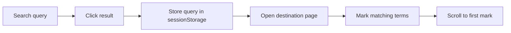

# Highlight terms on the page

When someone searches and opens a result, Docsense can highlight the query terms on the page they land on. That makes it easier to see why the page matched.

## What it is for

| Without highlights | With highlights |
| --- | --- |
| Reader lands on a long page and scans manually | Matching words are marked in the article body |
| Easy to lose the connection to the query | Query intent stays visible for a moment after navigation |

## How it works

1. The reader runs a query in the SearchBar.
2. On result click, Docsense stores the query in `sessionStorage` (short TTL).
3. After navigation, a client module finds the main article content, wraps matching terms in `<mark class="docsense-mark">`, and scrolls the first mark into view when the URL has no hash.



:::note
If the result URL includes a section hash (for example `#install-the-plugin`), the browser still scrolls to that heading. Highlights are applied in addition to the hash scroll.
:::

## What gets marked

Docsense tokenizes the query, then marks **whole words** on the page that either:

- match a query token exactly (case-insensitive), or
- share an English stem with a query token (so `installing` can mark `Install`)

It never paints a stem fragment such as `Instal` inside a longer word. Short stop words are skipped. Code blocks, `<pre>`, and `<kbd>` content are left alone so samples stay readable.

## Style the marks

```css
:root {
  --docsense-mark-bg: #fde68a;
  --docsense-mark-color: #111827;
}
```

See [Style the search UI](/docs/how-to/style-search) for a full theme example.

## Privacy and limits

- The pending query lives only in the reader’s `sessionStorage` and expires quickly.
- Highlights run entirely in the browser. Nothing is sent to a Docsense server.
- If storage is blocked, navigation still works; marks are simply skipped.

## Next steps

- **[Style the search UI](/docs/how-to/style-search)** - Theme marks with CSS variables.
- **[CSS variables](/docs/reference/css-variables)** - Full token list for the SearchBar and marks.
- **[Ranking and typos](/docs/concepts/ranking-and-typos)** - How query tokens are matched.
- **[FAQ](/docs/faq)** - Common product questions.
