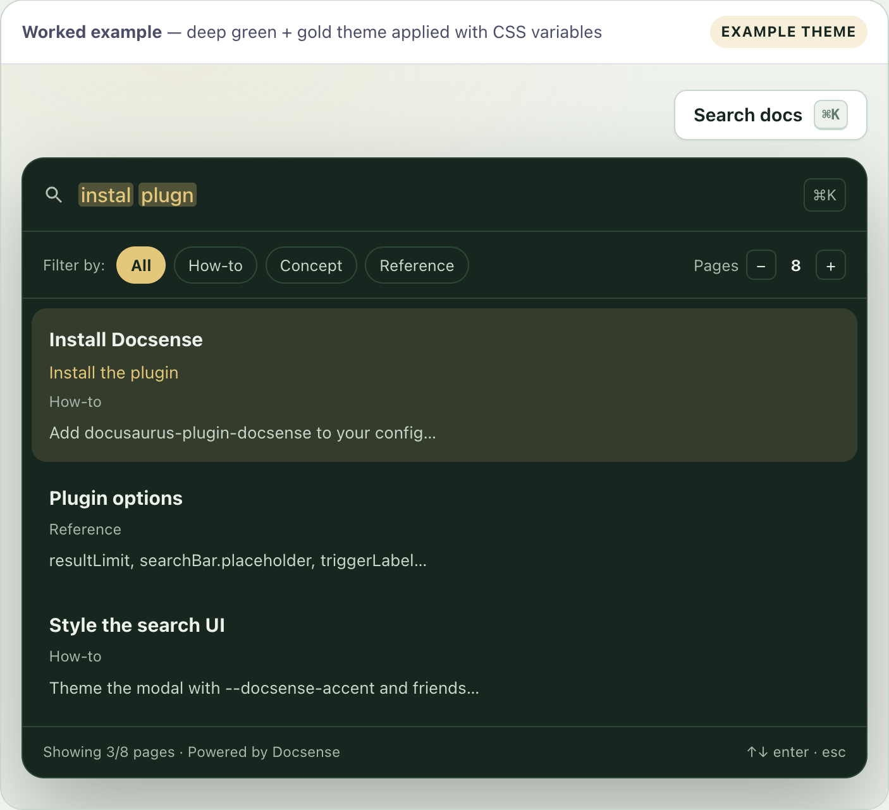

import Tabs from '@theme/Tabs';
import TabItem from '@theme/TabItem';
import SearchBarThemePreview from '@site/src/components/SearchBarThemePreview';

# Style the search UI

This page shows **how to customize the look** of the Docsense SearchBar.

You do not fork the component. You set CSS variables (and optional class tweaks) in your site stylesheet. Below is a **worked example**: a preview of the themed UI, then the exact CSS that creates it.

## Worked example (what you are building)

The preview is a static mock of the SearchBar using the Docsense deep green + gold palette. Scroll the code section next to copy the same look onto your site.

<SearchBarThemePreview />

:::tip Try the live SearchBar too
Press **⌘K** / **Ctrl+K** on this site. The live bar uses the same brand tokens from `src/css/custom.css`. The preview above is the teaching example so you can see the result even if the navbar is closed.
:::



## Copy this CSS

Put this in `src/css/custom.css` (or any stylesheet loaded by Docusaurus).

<Tabs>
  <TabItem value="brand" label="Deep green + gold (this example)" default>

```css
:root {
  /* Brand: deep green system + gold accent */
  --docsense-accent: #e3c77a;
  --docsense-accent-contrast: #17261e;

  --docsense-trigger-bg: #ffffff;
  --docsense-trigger-border: #c9d6cb;
  --docsense-trigger-color: #17261e;
  --docsense-trigger-radius: 999px;
  --docsense-trigger-padding: 0.45rem 0.95rem;

  /* Dark product modal: set fg/muted/border so text stays readable */
  --docsense-modal-width: 720px;
  --docsense-modal-radius: 16px;
  --docsense-modal-bg: #17261e;
  --docsense-modal-fg: #eef2ec;
  --docsense-modal-muted: #a9b8ad;
  --docsense-modal-border: #2e4739;
  --docsense-overlay: rgba(23, 38, 30, 0.55);

  --docsense-mark-bg: #e3c77a;
  --docsense-mark-color: #17261e;
}

[data-theme='dark'] {
  --docsense-trigger-bg: #1e3328;
  --docsense-trigger-border: #2e4739;
  --docsense-trigger-color: #eef2ec;
  --docsense-modal-bg: #17261e;
  --docsense-modal-fg: #eef2ec;
  --docsense-modal-muted: #a9b8ad;
  --docsense-modal-border: #2e4739;
  --docsense-overlay: rgba(13, 15, 34, 0.72);
  --docsense-mark-bg: rgba(227, 199, 122, 0.55);
  --docsense-mark-color: #eef2ec;
}

/* Optional polish */
.docsense-trigger {
  font-weight: 600;
  box-shadow: 0 1px 2px rgba(23, 38, 30, 0.08);
}

.docsense-trigger:hover {
  box-shadow: 0 0 0 3px rgba(227, 199, 122, 0.35);
}
```

  </TabItem>
  <TabItem value="pill" label="Pill trigger (minimal)">

```css
:root {
  --docsense-accent: #0f766e;
  --docsense-accent-contrast: #ffffff;
  --docsense-trigger-radius: 999px;
  --docsense-modal-radius: 16px;
  --docsense-modal-width: 680px;
}
```

  </TabItem>
</Tabs>

## What each variable controls

| Variable | What changes in the UI |
| --- | --- |
| `--docsense-accent` | Active filter chip, row hover, focus accents |
| `--docsense-accent-contrast` | Text on accent backgrounds |
| `--docsense-trigger-bg` / `border` / `color` | Navbar **Search docs** button |
| `--docsense-trigger-radius` | Button corners (default `999px` pill) |
| `--docsense-modal-bg` | Modal background |
| `--docsense-modal-fg` | Modal primary text (titles, input, chips) |
| `--docsense-modal-muted` | Secondary text (snippets, footer, labels) |
| `--docsense-modal-border` | Dividers and chip outlines |
| `--docsense-modal-width` / `radius` | Modal size and corners |
| `--docsense-overlay` | Dimmed backdrop |
| `--docsense-mark-bg` / `color` | Highlights on the destination page after a click |

:::warning Light mode tip
If you set a dark `--docsense-modal-bg`, you **must** also set `--docsense-modal-fg` (and ideally `--docsense-modal-muted` / `--docsense-modal-border`). Otherwise the site’s light-mode body text color can paint dark text on a dark modal and results look empty.
:::

## Wire the stylesheet

```ts title="docusaurus.config.ts"
presets: [
  [
    'classic',
    {
      theme: {
        customCss: './src/css/custom.css',
      },
    },
  ],
],
```

:::note Labels vs colors
Changing **copy** (placeholder, trigger label, shortcut) is done in plugin options. See [Customize the search bar](/docs/how-to/customize-search-bar). This page is only about **look and feel**.
:::

## Destination-page marks

After a result click, matching terms can be wrapped in `<mark class="docsense-mark">`. Style them with `--docsense-mark-bg` and `--docsense-mark-color` as in the example.

See [Highlight terms on the page](/docs/features/highlight-on-page).

## Full variable list

See [CSS variables](/docs/reference/css-variables).

## Next steps

- **[CSS variables](/docs/reference/css-variables)** - Complete token reference.
- **[Customize the search bar](/docs/how-to/customize-search-bar)** - Labels, shortcut, and empty-state copy.
- **[Highlight terms on the page](/docs/features/highlight-on-page)** - Destination-page marks after a result click.
- **[FAQ](/docs/faq)** - Common product questions.
