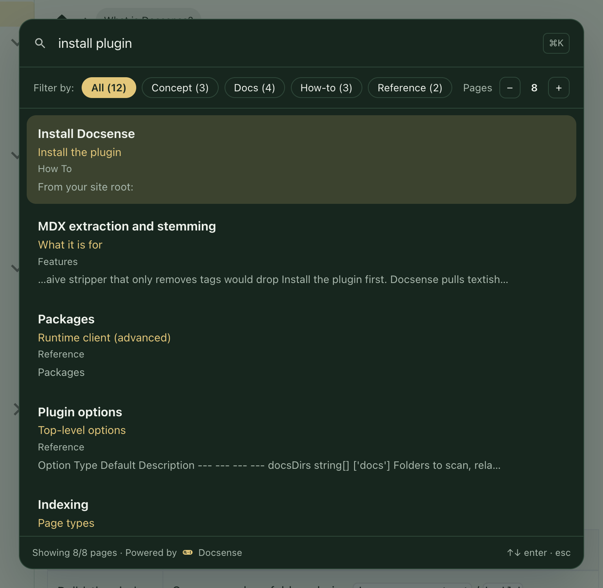

# What is Docsense?

Docsense is documentation search for [Docusaurus](https://docusaurus.io/).

It indexes your Markdown and MDX files when you build your site, then serves search from a static JSON file that ships with your docs. There is no Algolia account, no crawler, and no separate search server.

Press **⌘K** (macOS) or **Ctrl+K** (Windows/Linux) on this site to try it.

## Who it is for

Use Docsense if you want to:

- Add search to a Docusaurus site without a hosted search product
- Keep the search index in sync with every docs deploy
- Search private or internal docs without sending content to a third-party crawler
- Own and inspect the index file yourself

## What you get

| Feature | What it does |
| --- | --- |
| Build-time index | Scans your docs folders during `docusaurus start` / `build` |
| Search modal | Navbar trigger plus keyboard shortcut |
| Section results | Hits point to headings, not only page titles |
| Filters | Narrow results by page type (How-to, Concept, Reference, and more) |
| Page limit | Default **8** pages. Readers change the count with − / +. The − control stops at **3** (it will not go lower). The + control stops at **20**. |
| Typo tolerance | Finds results even when a query has small spelling mistakes |
| Custom labels and CSS | Change copy, shortcut, and colors to match your site |

## How it fits together

1. You add the `docusaurus-plugin-docsense` plugin.
2. On each build, Docsense reads your docs and writes `static/docsense/search-index.json`.
3. Readers open search in the browser. Queries run locally against that JSON file.

## Next steps

- **[Why Docsense](/docs/concepts/why-docsense)** - The market problem and business case for local docs search.
- **[Install Docsense](/docs/how-to/install)** - Add the plugin and rebuild once.
- **[Features overview](/docs/features/overview)** - What ships today and what is on the roadmap.
- **[How Docsense works](/docs/concepts/how-docsense-works)** - Build-time index and in-browser search flow.
- **[Compare open-source Docusaurus search](/docs/concepts/compare-open-source-search)** - Choose among Docsense, easyops, Orama, Pagefind, and DocSearch.
